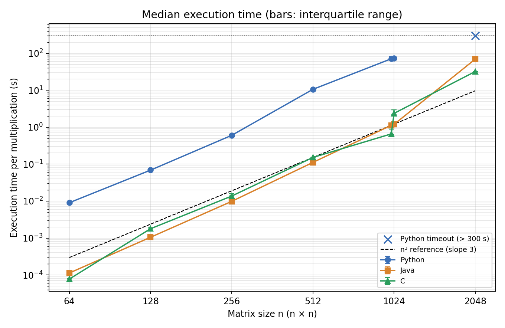

# Assignment 1 – Basic Matrix Multiplication in Python, Java and C

Research question: *How does the matrix size n affect the execution time and the memory use of the same
basic triple-loop matrix multiplication implemented in Python, Java and C?*

The report is [`report/Assignment01_AlvarezGonzalez_Report.pdf`](report/Assignment01_AlvarezGonzalez_Report.pdf).

## Main results

Median time of one multiplication (seconds), every process pinned to one performance core of an Intel Core
Ultra 7 155H. Full data, quartiles and memory in `results/summary.csv`.

| n | Python | Java | C |
|---:|---:|---:|---:|
| 64 | 0.00906 | 0.000113 | 0.0000777 |
| 128 | 0.0689 | 0.00105 | 0.00179 |
| 256 | 0.604 | 0.00984 | 0.0137 |
| 512 | 10.60 | 0.111 | 0.152 |
| 1000 | 71.31 | 1.129 | 0.659 |
| 1024 | 72.80 | 1.194 | 2.373 |
| 2048 | timeout (> 300 s) | 69.73 | 32.18 |

- The three implementations produce bit-identical results on the same inputs.
- Time grows as n³ only while the data fits in the caches; the fitted exponents over n = 256–2048 are 3.4–4.1.
- The contiguous C layout is 3.6× slower at n = 1024 than at n = 1000 (power-of-two cache conflicts);
  Java and Python are not affected. No language is the fastest for every size.
- Without CPU affinity the hybrid processor made the results up to 2.7× slower and much more variable.



## Contents

| Path | Description |
|---|---|
| `src/python/matmul.py` | Triple loop, lists of lists of Python floats |
| `src/java/MatMul.java` | Triple loop, `double[][]` |
| `src/c/matmul.c` | Triple loop, contiguous row-major `double` array |
| `config.json` | Every experimental parameter: seed, sizes, repetitions, warm-ups, budgets, flags, tolerances |
| `scripts/core_probe.py` | Speed of every logical processor (hybrid CPU) → `results/core_probe.csv` |
| `scripts/generate_inputs.py` | Creates the shared input matrices in `data/` (+ SHA-256 manifest) |
| `scripts/verify.py` | Correctness tests → `results/correctness.csv` |
| `scripts/run_experiment.py` | Benchmark harness → `results/raw_measurements.csv`, `results/memory.csv`, `results/environment.json` |
| `scripts/analyze.py` | Summary tables and figures → `results/summary.csv`, `results/fit.csv`, `results/fig*.png` |
| `results/` | Raw measurements, summaries, figures and the log of the reported run |
| `results/preliminary_run_unpinned/` | Preliminary run without CPU affinity (kept as evidence, not used for the main results) |
| `report/` | Report source (LaTeX, `report.tex` + `figures/`) and final PDF |

All three programs share the same interface:

```
<program> bench <n> <warmups> <reps> <data_dir>      # prints "<warmup|rep> <seconds> <checksum_bits>" per multiplication
<program> multiply <n> <A.bin> <B.bin> <C.bin>       # one multiplication, used by the tests
```

## Requirements

Versions used for the reported run (see `results/environment.json` for the full environment):

- Python 3.13.0 with the packages in `requirements.txt` (NumPy is used only to generate inputs and as the correctness reference)
- Java JDK 21.0.5 (`javac` and `java` in `PATH`)
- GCC 16.2.0 (MinGW-w64 on Windows; `gcc` in `PATH`)
- Windows 11. The memory measurement uses the Win32 `GetProcessMemoryInfo` API; on other systems the timing works but memory is not recorded.

## Quick run (a few seconds)

After the inputs have been generated and the programs built (steps below), one size can be run directly from the
`assignment1` folder. Each line printed is `<warmup|rep> <seconds> <checksum_bits>`; the checksum is identical in
the three languages.

```bash
python src/python/matmul.py bench 256 1 3 data
java -cp build MatMul bench 256 1 3 data
build/matmul.exe bench 256 1 3 data
```

## How to reproduce

From the `assignment1` folder (the full benchmark takes about 40 minutes):

```bash
cd scripts
pip install -r ../requirements.txt
python core_probe.py           # optional: find the performance cores of the machine
python generate_inputs.py      # shared inputs (about 90 MB, not stored in git)
python verify.py               # builds the programs and runs the correctness tests
python run_experiment.py       # full benchmark, about 50 minutes
python analyze.py              # tables and figures
```

`run_experiment.py` compiles the programs itself with the flags in `config.json`:

```bash
gcc -O2 -std=c11 -o build/matmul.exe src/c/matmul.c
javac -d build src/java/MatMul.java
java -Xmx4g -XX:+UseSerialGC -cp build MatMul bench <n> <warmups> <reps> data
```

Every benchmark process is started pinned to the logical processor listed in `cpu_affinity` (12, a
performance core of the Intel Core Ultra 7 155H used for the report) with high priority. On another
machine, run `core_probe.py` and change `cpu_affinity` in `config.json` to one of its fastest cores.

A subset can be run with `python run_experiment.py --sizes 64 128 --languages C Java`.

## Inputs

For each size n, A and B are generated with `numpy.random.default_rng(42 + n)` (PCG64), uniform `float64`
values in [0, 1), and stored as raw little-endian `float64` in row-major order. Every implementation
reads the same files, so all languages multiply the same logical matrices. `data/manifest.csv` records
the seed and the SHA-256 hash of each file.
